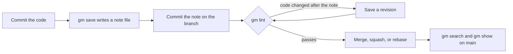

# gm

gm keeps a project's memory in the repository it is about. Each note is a markdown file in `.memory/notes/`, committed with the code it describes and merged by git. There is no server, no database, and no index file.

## Install gm

To try gm without installing it, run it from the flake:

```sh
nix run github:vabatta/gm -- help
```

To install gm with home-manager, add the flake as an input and enable the module:

```nix
# flake.nix
inputs.gm.url = "github:vabatta/gm";

# home configuration
imports = [ inputs.gm.homeManagerModules.default ];
programs.gm.enable = true;
```

The module installs the `gm` binary and the man pages gm(1) and gm-note(5). For Claude Code, it also links the memory skill into `~/.claude/skills/memory` and adds a SessionStart hook that runs `gm context`. To install only the binary and the man pages, set `programs.gm.claudeCode = false`.

## Save and find a note

Run every command from the root of a git repository.

1. Commit the code that the note is about.
2. Save the note, anchored to that code:

   ```sh
   gm save decision --title "Cache uses Postgres" --keywords "cache store redis" \
     --decision "Keep the cache in Postgres." \
     --why "One fewer service to run; the hit rate is the same." \
     --rejected "Redis: another service for no measured gain." \
     --at internal/cache/store.go
   ```

3. Commit the new file in `.memory/notes/` on the same branch.
4. Later, on any branch that has the note, find it and read it with its code:

   ```sh
   gm search cache store
   gm show ID
   ```

Before you merge a branch, run `gm lint`. It fails while a note on the branch describes code that changed after the note.

## How notes move with the code

A note is never edited. To change one, save a new note that names the old one with `--supersedes`. Because every save adds a new file, branches that save notes in parallel merge without conflicts, whether you merge, squash, or rebase.



An anchor names a file, and optionally a line range, at the commit where the note was saved. `gm show` prints the code at that commit. After a squash or a rebase, that commit is gone, so gm reads the code at the commit that added the note instead.

## What a note holds

A note holds what a later reader needs and the repository cannot tell them: why the code is this way rather than the obvious alternative, what failed and why, or a fact from outside the repository that the code depends on. What the code, the tests, the docs, or the git log already say does not belong in a note.

## Read the manual

- `man gm` describes every command, option, and rule.
- `man 5 gm-note` describes the note file format.
- [skills/memory/SKILL.md](skills/memory/SKILL.md) tells agents when to search and when to save.

## Work on gm

To enter the dev shell, run `direnv allow` once, or run `nix develop`. A change is done when `nix flake check` passes. [AGENTS.md](AGENTS.md) holds the rules of the code and the work.
